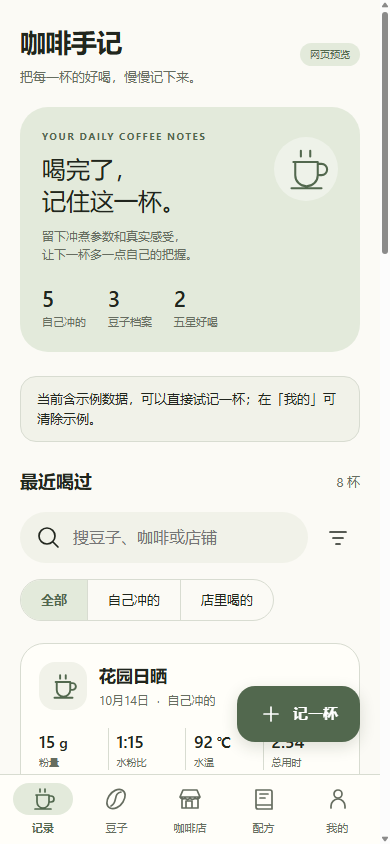
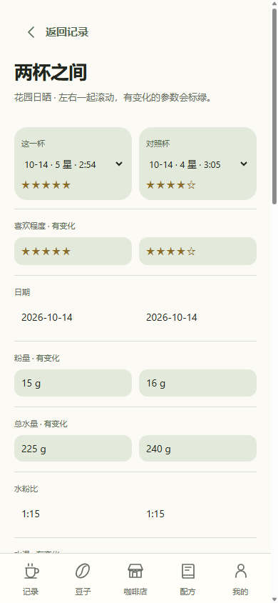
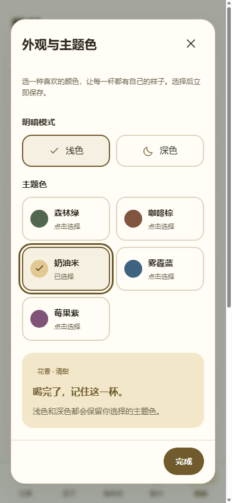
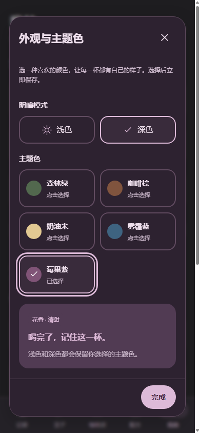

# 咖啡手记 · Coffee Notes

喝完了，记住这一杯。面向咖啡爱好者的离线手冲与咖啡店记录应用。

[下载 Android 安装包](https://github.com/KING-HAO-csu/coffee-notes/releases/tag/v0.1.2) · [安装说明](docs/INSTALL.md) · [隐私说明](PRIVACY.md) · [安全审查记录](docs/SECURITY-REVIEW-v0.1.2.md)

适合冲完、品尝之后快速补记：记录参数和感受，对比同一款豆子的不同冲法，把下次想调整的地方留下来。无需注册账号，日常使用无需联网。

## 预览

以下为网页预览截图，全部内容来自标记过的虚构示例数据。

 

0.1.2 新增主题色选择，下面分别为奶油米浅色与莓果紫深色：

 

## 可以记录什么

| 模块 | 内容 |
| --- | --- |
| 豆子档案 | 名称、烘焙程度、品牌、产地、品种、处理方式、照片与备注 |
| 冲煮补记 | 粉量、总水量、自动水粉比、水温、总用时；可选分段累计水量和时间 |
| 研磨设置 | 数字刻度、几圈几格、粒径对照卡，按自己的磨豆机设置 |
| 品尝感受 | 喜欢程度、酸甜苦强度，以及分类的风味和口感词条 |
| 两杯对比 | 同款豆子的两次手冲双列共同滚动，突出参数差异，记录下次调整 |
| 咖啡店 | 店铺、品饮记录、饮品类型、奶与其他配料、店家豆子信息 |
| 日常管理 | 草稿、配方复用、筛选搜索、30 天内恢复删除、JSON 备份与恢复 |
| 外观 | 安卓 Material 风格，适配手机和宽屏，五种主题色与浅色、深色模式 |

在「我的 → 外观与主题色」中选择森林绿、咖啡棕、奶油米、雾霾蓝或莓果紫，选择后立即保存，备份也会保留外观设置。初次打开包含演示记录，可在「我的」中清除示例。当前没有云同步或账号系统。

当前版本 **0.1.2**：新增主题色选择，改善窄屏下「新豆子」「新店铺」按钮的单行显示。详见 [0.1.2 更新说明](docs/RELEASE-v0.1.2.md)。

## Android 使用

支持 Android 8.0 及以上，需要可用的 Android System WebView。

1. 从 [0.1.2 发布页](https://github.com/KING-HAO-csu/coffee-notes/releases/tag/v0.1.2) 下载 `coffee-notes-0.1.2.apk`。
2. 传到手机，点开安装；系统询问时允许当前文件来源安装。
3. 先试记一杯，再关闭、重开应用确认保存成功。

数据保存在本机。网页与 APK 分别保存资料，迁移时在「我的」导出备份，再在另一端恢复。**卸载或清除应用数据前请先备份。** JSON 备份是明文，可能包含你填写的备注、地点、图片和价格，请妥善保管。

0.1.2 沿用原有发布签名，可直接覆盖安装；旧数据未设置主题色时继续使用森林绿。当前完成 11 项核心数据、126 项网页与 17 项安卓接口模拟检查，尚未完成真实安卓设备验收；照片选择、系统文件保存、系统栏配色和各厂商返回手势仍需真机验证。

## 本地开发

网页使用原生 HTML、CSS 和 JavaScript；安卓版用一个 Android Activity 加载内置页面，没有第三方运行时 SDK，也不申请联网权限。项目不需要 npm 依赖。

### 网页预览

安装 Node.js 22 或更新版本，在仓库根目录运行：

```sh
node work/coffee-preview/build.cjs
```

用浏览器打开生成的 `outputs/coffee-preview/index.html`。也可以下载 Release 中的独立网页文件后直接打开。

### 构建 APK

现有构建脚本支持 Windows，需要 Node.js 22+ 和 JDK 17。确保 `javac` 在 PATH 中，或配置 `JAVA_HOME`。

```sh
node work/coffee-android/bootstrap.cjs
node work/coffee-android/build.cjs
```

准备脚本从 Google 官方仓库下载固定版本的 Build Tools 35.0.0 和 Android 35 Platform，校验后解压。构建结果位于 `outputs/coffee-android/`。其他操作系统尚未提供构建脚本。

首次构建会生成自己的签名密钥，保存在被 Git 忽略的 `work/coffee-android/signing/`。自行构建的 APK 与官方 Release 签名不同，不能直接覆盖官方版本。请私下备份自己的签名材料；更新应用需使用同一签名并递增版本。仓库和源码包不包含发布私钥。

也可通过 `COFFEE_ANDROID_SIGNING` 指定已有签名目录，复用原签名构建更新包；该目录需包含本项目生成的密钥和密码文件，不能提交到仓库。

### 验证

```sh
node --test work/coffee-preview/tests.cjs
node work/coffee-preview/build.cjs
node work/coffee-preview/browser-qa.cjs
node work/coffee-android/bridge-qa.cjs
node tools/audit-release.cjs
```

浏览器检查需要 Google Chrome，可通过 `COFFEE_CHROME_PATH` 指定可执行文件。它们使用项目内独立测试资料目录，原生接口检查采用模拟接口，不能代替安卓真机测试。APK 构建会另外验证签名、应用标识和 ZIP 对齐。

## 贡献与许可

欢迎提交复现步骤和改进建议。请使用虚构数据，勿在 Issue 或附件中提交真实备份、照片、私人邮箱、密钥或财务资料。安全相关问题请参阅 [SECURITY.md](SECURITY.md)。

本项目采用 [MIT License](LICENSE)。
